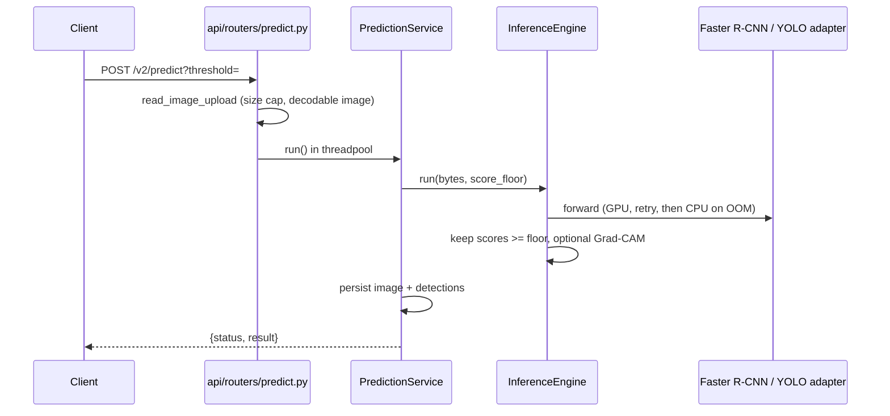

# Architecture

## Layers

```
ml/                  shared kernel: no FastAPI, no training loop
  core/              entities, constants, BraTS region labels, post-processing
  models/            model factories and loaders (Faster R-CNN, YOLOv8, SwinUNETR)
  transforms/        inference transforms (no color augmentation on MRI)
  config/            shared Pydantic training configs
backend/             inference and web shell
  api/routers/       HTTP layer only: parse request, call a service, map errors
  pipeline/          InferenceEngine (decode, OOM fallback, score floor) + adapters
  services/          business logic; no FastAPI types except UploadFile reading
  repositories/      SQLAlchemy queries
  models/            ORM models
  schemas/           Pydantic HTTP schemas
  core/              settings-independent infrastructure (db, security, logging)
training/            training shell: data, trainer, scripts, notebooks, tests
registry/            promoted weights (gitignored) + metadata.json (committed)
```

## Import rules

- `backend` imports `ml`; `training` imports `ml`.
- `backend` never imports `training`; `training` never imports `backend`.
- `ml` imports neither.
- Routers call services; services call repositories and `pipeline`; only
  repositories build queries.

## Inference flow



- v1 (`/predict`, `/predict-yolo`) filters at `threshold` and returns a bare
  `PredictionResult`.
- v2 (`/v2/predict`, `/v2/predict/yolo`) keeps detections down to
  `min(threshold, 0.1)` so the client slider can filter; the requested
  threshold is stored with the scan. History, PDF reports, and statistics show
  only detections at or above that stored threshold.
- Models are cached per process on the primary device; an OOM fallback loads a
  fresh CPU copy without touching the cache.

## Segmentation flow

`POST /case-viewer/cases/{id}/segment` runs SwinUNETR once per case (one job at
a time), stores the mask in the case store, and returns NCR/ED/ET volumes.
`GET .../volume?type=pred` then streams the mask as NIfTI. Model output
channels are nested regions (TC, WT, ET) and are decoded to BraTS labels by
painting WT as ED (2), then TC as NCR (1), then ET (4).

## Artifacts

- Faster R-CNN: `registry/faster_rcnn/<version>/model.safetensors`, loaded with
  strict key matching.
- YOLOv8: `registry/yolo/<version>/yolov8_tumor.pt`, verified against
  `weights_sha256` in `metadata.json` when present.
- Weights are never baked into images; Compose mounts `./registry` and
  `./checkpoints` read-only.

## Naming conventions

| Scope | Convention | Example |
|---|---|---|
| Python packages, modules | `snake_case` | `ml/models/swin_unetr.py` |
| Python functions, variables | `snake_case`, verbs for functions | `read_image_upload` |
| Python classes | `PascalCase` | `FasterRCNNAdapter` |
| Python constants | `UPPER_SNAKE_CASE` | `FASTER_RCNN_CLASS_NAMES` |
| Private helpers | leading `_` | `_segmentor` |
| Model names in identifiers | spelled out: `faster_rcnn`, `yolo`, `swin_unetr` | not `frcnn` |
| Settings / env vars | `snake_case` field = `UPPER_SNAKE_CASE` env | `faster_rcnn_registry_version` / `FASTER_RCNN_REGISTRY_VERSION` |
| Python tests | `test_<module>.py`, `test_<behavior>` | `test_swin_unetr.py` |
| React components | `PascalCase.tsx` | `CaseViewer.tsx` |
| TS modules, functions, variables | `camelCase` | `lib/drawScan.ts`, `downloadReport` |
| TS types | `PascalCase` | `PredictionResult` |
| TS tests | `<module>.test.ts` next to the module | `session.test.ts` |
| Notebooks | `<model>_<purpose>.ipynb` | `yolov8_training.ipynb` |
| Docs in `docs/` | `kebab-case` | `inference-flow.html` |
| API model type values | `faster-rcnn`, `yolov8` | |
| Registry model keys | `faster_rcnn`, `yolo` | |

Documentation uses plain text: no emoji or icon characters.
