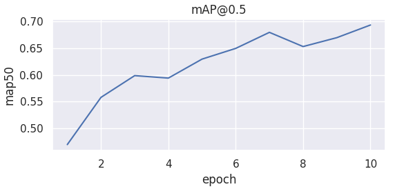
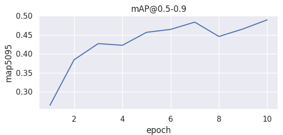

# Faster R-CNN Object Detection Application
- An end-to-end object detection system for detecting brain tumors in MRI images using Faster R-CNN with ResNet-50 backbone.
- The system allows users to upload images via a web interface and receive detected objects with bounding boxes in real time.
- As of January 7, 2026, the application is a web-based object detection system built using PyTorch, FastAPI, and React.

## Results
The following results demonstrate the performance of the Faster R-CNN model on validation MRI images after 10 training epochs.
- mAP@0.5: **0.69**

- mAP@0.5-0.9: **0.49**


## Problem Statement
- Brain tumor detection in MRI images is a critical task in medical imaging.
- Manual annotation is time-consuming and prone to human error.
- This project aims to automatically detect tumor regions using deep learning–based object detection.

## Architecture
See [ARCHITECTURE.md](ARCHITECTURE.md) for Pipeline Clean Architecture (`ml/` kernel, `backend/` serve shell, `training/` train shell).

```
Browser (Frontend)
    |
    | HTTP (Image Upload)  — v1 bare contract
    v
Backend API (FastAPI)  — /predict, /v2/predict
    |
    | pipeline → ml.backbone
    v
Faster R-CNN / YOLO
    |
    v
Detection Results (+ optional Grad-CAM on v1 / v2?explain=true)
```

## Dataset
- Source: Kaggle – Brain-tumor dataset by Ultralytics
- Documentation: https://docs.ultralytics.com/datasets/detect/brain-tumor/
- Total images: 1116
  - Train: 893
  - Test: 223
- Dataset configuration: brain-tumor.yaml
- Classes: Brain tumor
- Annotation format: YOLO
- Place under `data/raw/vN/` (gitignored); verify with `training/scripts/verify_dataset.py`

## Methodology
1. Data preprocessing
2. Train Faster R-CNN with ResNet-50
3. Loss optimization (classification + bounding box regression)
4. Evaluation using Precision, Recall, mAP
5. Deployment-ready inference accessible via localhost web interface

## Model & Training
- Framework: PyTorch (Torch and TorchVision)
- Backbone: ResNet-50
- Optimizer: SGD
- Learning rate: 0.005
- Epochs: 10
- Hardware: NVIDIA GPU T4
- Train scripts: `training/scripts/train_faster_rcnn.py`, `train_yolo.py`
- Promote FRCNN weights: `training/scripts/export_safetensors.py`

## Project Structure
```
├── ml/                     # shared ML kernel
│   ├── backbone/
│   ├── core/
│   ├── config/
│   └── transforms/
├── backend/                # FastAPI serve shell (Python package)
│   ├── pipeline/
│   ├── api/                # v1 + v2
│   ├── services/
│   ├── alembic/
│   └── tests/
├── training/               # train / eval / export
│   ├── scripts/
│   ├── trainer/
│   ├── data/
│   └── notebooks/          # EDA only
├── registry/               # promoted artifacts + metadata
├── checkpoints/            # local/dev weights
├── data/raw/               # versioned datasets (gitignored)
├── frontend/               # React (API v2 by default)
├── models/                 # archived notebooks
├── ARCHITECTURE.md
└── README.md
```

## Installation
### 1. Clone this repo
```bash
git clone https://github.com/NguyenHuuPhat2203/Web-Based-Faster-R-CNN-Object-Detection-System.git
cd Web-Based-Faster-R-CNN-Object-Detection-System

# Create and activate a virtual environment (example: Side_Project root)
cd ..
python -m venv .venv
# On Windows:
.venv\Scripts\activate
# On Linux/macOS:
# source .venv/bin/activate

pip install torch torchvision --index-url https://download.pytorch.org/whl/cpu
pip install -r Brain_Tumor_FasterRCNN/backend/requirements.txt
pip install -r Brain_Tumor_FasterRCNN/backend/requirements-dev.txt
```

Always run Python commands from the **repo root** (`Brain_Tumor_FasterRCNN/`) so `import ml` and `import backend` resolve via the working directory. Do **not** `pip install -e .` for this repo (tooling-only `pyproject.toml`). If you previously installed `brain-tumor-workspace`, run `pip uninstall brain-tumor-workspace`.

### 2. Training (Deep Learning)
- One-shot local E2E smoke (download → subsample 16/8 → 1 epoch FRCNN + YOLO):
```bash
python -m training.scripts.run_e2e_smoke
```
- Individual steps:
```bash
python -m training.scripts.download_dataset          # Ultralytics zip → data/raw/v1
python -m training.scripts.subsample_dataset         # → data/raw/v1-smoke (gitignored)
python -m training.scripts.train_faster_rcnn --epochs 1 \
  --images data/raw/v1-smoke/train/images \
  --labels data/raw/v1-smoke/train/labels \
  --output-dir training/outputs/e2e_smoke/faster_rcnn
python -m training.scripts.train_yolo --epochs 1 \
  --data data/raw/v1-smoke/brain-tumor.yaml \
  --project training/outputs/e2e_smoke/yolo
```
- Full train (after smoke): `train_faster_rcnn` / `train_yolo` on `data/raw/v1` with default epochs.
- Promote (explicit version; refuses `v1.0.0` without `--i-know`):
```bash
python -m training.scripts.promote_checkpoint --model faster_rcnn \
  --checkpoint training/outputs/faster_rcnn/best_model.pth --version v1.1.0
```
- Or HF → registry: `python -m training.scripts.promote_from_hf`
- Legacy notebooks under `models/` are archived (see `models/README.md`).

### 3. Backend (FastAPI)
- From the **repo root**:
```bash
python -m uvicorn backend.main:app --reload
```
- The API will be available at `http://localhost:8000`.
- Health: `GET /healthz` (includes `model_version`). Metrics: `GET /metrics`.
- Migrations: `alembic -c backend/alembic.ini upgrade head`

### 4. Frontend (React)
- Install dependencies:
```bash
cd frontend
npm install
```
- Run development server:
```bash
npm run dev
```
- Open the provided URL:`http://localhost:8001`.
- Predict API defaults to **v2** (`/v2/predict`, item-schema). Rollback:
```bash
# frontend/.env
VITE_API_VERSION=v1
```
  Then restart Vite (or rebuild Docker with `VITE_API_VERSION=v1`).
- Detector requests Grad-CAM (`explain=true`) for Faster R-CNN; webcam always uses `explain=false`.

### 5. Docker Compose (thin image + mounted weights)
```bash
# Optional: materialize registry weights on the host first
python -m training.scripts.promote_from_hf

docker compose up --build
```
- Backend: `http://localhost:8000` (mounts `./registry`, `./checkpoints` read-only)
- Frontend: `http://localhost:8001` (starts after backend `/healthz` is healthy)
- Image does **not** bake model weights; missing local weights fall back to Hugging Face at runtime.

## Future Works
- Try YOLO models for faster inference
- Deploy the model as a portable application
- Real-time detection using webcam

## Author(s)
Nguyen Huu Phat
Email: phat.nguyenluxefats@gmail.com  
GitHub: https://github.com/NguyenHuuPhat2203
