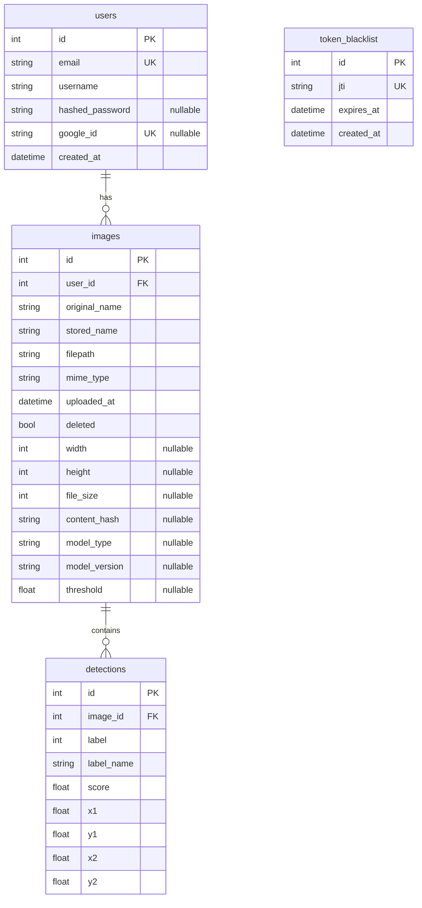

# Database Redesign — Brain Tumor Detector

**Date:** 2026-06-01
**Author:** Claude Code
**Status:** Approved
**Goal:** Improve the local SQLite database schema by normalizing detection results, adding image metadata and model provenance, introducing Alembic migrations, and adding token blacklist cleanup — while keeping SQLite as the backing store.

---

## 1. Technology & Configuration

- **Database:** SQLite (unchanged), accessed via SQLAlchemy ORM.
- **Connection string:** `sqlite:///./brain_tumor.db` (controlled by `DATABASE_URL` env var).
- **Migrations:** Alembic, initialized in `backend/alembic/`.
- **Session management:** Unchanged — `SessionLocal` factory in `database.py`, `get_db` dependency in FastAPI.

**Alembic setup steps:**
1. `cd backend && pip install alembic`
2. `alembic init alembic`
3. Configure `alembic.ini` to read `DATABASE_URL` from env
4. Wire `env.py` to import `Base` from `database.py`
5. Generate initial migration capturing current schema as-is
6. Generate subsequent migrations for the schema changes described below

---

## 2. Schema: `users` — Unchanged

```python
class User(Base):
    __tablename__ = "users"

    id: int
    email: str                          # unique, indexed
    username: str
    hashed_password: str | None         # None for Google-only users
    google_id: str | None               # unique
    created_at: datetime

    images: list[Image]                 # relationship, back_populates="user"
```

No column changes. Add `ondelete="CASCADE"` on FK to images table.

---

## 3. Schema: `token_blacklist` — Unchanged + Cleanup

```python
class TokenBlacklist(Base):
    __tablename__ = "token_blacklist"

    id: int
    jti: str                            # unique, indexed
    expires_at: datetime
    created_at: datetime
```

**New utility:**

```python
def purge_expired_tokens(db: Session) -> None:
    """Remove expired tokens from the blacklist."""
    db.query(TokenBlacklist).filter(
        TokenBlacklist.expires_at < datetime.now(timezone.utc)
    ).delete()
    db.commit()
```

Called on app startup in `main.py`.

---

## 4. Schema: `images` — Enhanced

```python
class Image(Base):
    __tablename__ = "images"

    # ── Existing columns ──
    id: int                             # PK
    user_id: int                        # FK → users.id, ondelete=CASCADE
    original_name: str
    stored_name: str                    # UUID-based filename
    filepath: str
    mime_type: str
    uploaded_at: datetime               # default=utcnow
    deleted: bool                       # soft delete, default=False

    # ── NEW: Image metadata ──
    width: int | None                   # pixel width of the uploaded image
    height: int | None                  # pixel height
    file_size: int | None               # file size in bytes
    content_hash: str | None            # SHA-256 of file contents

    # ── NEW: Model provenance (one result per image) ──
    model_type: str | None              # "faster-rcnn" | "yolov8"
    model_version: str | None           # checkpoint ref (e.g. "resnet50-fpn-v1")
    threshold: float | None             # confidence threshold used during inference

    # ── Relationships ──
    user: User                          # back_populates="images"
    detections: list[Detection]         # cascade="all, delete-orphan"

    # ── REMOVED ──
    # detection_result: JSON (migrated to detections table)
```

**Indexes (new):**
- `(user_id, deleted, uploaded_at DESC)` — fast history query
- `(user_id, deleted)` — fast soft-delete filter

---

## 5. Schema: `detections` — New

```python
class Detection(Base):
    __tablename__ = "detections"

    id: int                             # PK
    image_id: int                       # FK → images.id, ondelete=CASCADE

    label: int                          # numeric class ID
    label_name: str                     # human-readable (e.g. "Brain tumor")
    score: float                        # confidence score [0, 1]

    # Bounding box in pixel coordinates
    x1: float
    y1: float
    x2: float
    y2: float

    # Relationships
    image: Image                        # back_populates="detections"
```

**Indexes:**
- `image_id` (auto by FK)
- `(image_id, score DESC)` — for Grad-CAM "best detection" lookup

---

## 6. Pydantic Schemas

```python
class DetectionOut(BaseModel):
    label: int
    label_name: str
    score: float
    x1: float
    y1: float
    x2: float
    y2: float
    model_config = {"from_attributes": True}


class ImageOut(BaseModel):
    id: int
    original_name: str
    mime_type: str
    uploaded_at: datetime
    width: int | None = None
    height: int | None = None
    file_size: int | None = None
    model_type: str | None = None
    model_version: str | None = None
    threshold: float | None = None
    detections: list[DetectionOut] = []
    model_config = {"from_attributes": True}


class PredictionResult(BaseModel):
    boxes: list[list[float]]
    labels: list[int]
    scores: list[float]
    label_names: list[str]
    heatmap: str | None = None
    # NEW fields
    model_type: str | None = None
    model_version: str | None = None
```

---

## 7. Backend Code Changes

### `backend/models.py`
- Add `Detection` model
- Update `Image` model: remove `detection_result`, add new columns + relationships
- Add `ondelete="CASCADE"` to `Image.user_id` FK
- Add `purge_expired_tokens()` function

### `backend/schemas.py`
- Add `DetectionOut`
- Update `ImageOut` to include `detections` and metadata fields
- Update `PredictionResult` to include `model_type`, `model_version`

### `backend/routers/predict.py`
After inference, save detections as individual rows:
```python
db_image = ImageModel(
    user_id=current_user.id,
    original_name=...,
    stored_name=...,
    filepath=...,
    mime_type=...,
    width=image.width, height=image.height,
    file_size=len(contents),
    content_hash=hashlib.sha256(contents).hexdigest(),
    model_type="faster-rcnn",
    model_version="resnet50-fpn-v1",
    threshold=threshold,
)
db.add(db_image)
db.flush()
for box, label, score, label_name in zip(...):
    db.add(Detection(image_id=db_image.id, label=label, label_name=label_name,
                     score=score, x1=box[0], y1=box[1], x2=box[2], y2=box[3]))
db.commit()
```

### `backend/routers/predict_yolo.py`
Same pattern with `model_type="yolov8"`, `model_version="yolov8n"`.

### `backend/routers/images.py`
- `list_images` — `ImageOut` auto-loads `detections` via relationship
- `get_image` / `delete_image` — unchanged
- `generate_report` — read from `img.detections` instead of `img.detection_result`

### `backend/main.py`
Add token cleanup on startup:
```python
from models import purge_expired_tokens
with SessionLocal() as db:
    purge_expired_tokens(db)
```

---

## 8. API Response Changes

**`GET /images`** response shape:
```json
{
  "images": [{
    "id": 1,
    "original_name": "scan.jpg",
    "mime_type": "image/jpeg",
    "uploaded_at": "2026-06-01T12:00:00Z",
    "width": 512,
    "height": 512,
    "file_size": 123456,
    "model_type": "faster-rcnn",
    "model_version": "resnet50-fpn-v1",
    "threshold": 0.5,
    "detections": [
      {"label": 1, "label_name": "Brain tumor", "score": 0.92,
       "x1": 100, "y1": 150, "x2": 200, "y2": 250}
    ]
  }]
}
```

**`POST /predict`** / **`POST /predict-yolo`** — adds `model_type` and `model_version` to response, otherwise shape unchanged.

---

## 9. Frontend Impact

**Minimal.** The frontend accesses `detection_result.boxes / labels / scores` objects. The `ImageOut` → `ImageInfo` interface returns `detection_result`-shaped data via the nested objects. If needed, the frontend's `ImageInfo` type in `api.ts` is updated to match:

```typescript
export interface ImageInfo {
  id: number;
  original_name: string;
  mime_type: string;
  uploaded_at: string;
  width?: number;
  height?: number;
  model_type?: string;
  threshold?: number;
  detection_result: {  // kept for backwards compat
    boxes: number[][];
    labels: number[];
    scores: number[];
    label_names: string[];
  } | null;
}
```

---

## 10. Migration Plan

### Alembic revision list

| Revision | Description |
|----------|-------------|
| `001_create_initial_tables.py` | Creates current schema (fresh installs) |
| `002_add_metadata_and_detections.py` | Add new columns to images, create detections, migrate existing data, drop `detection_result` |
| `003_add_indexes.py` | Add composite indexes |

### `002` data migration logic

```python
def upgrade():
    # Add new columns (nullable so existing rows pass)
    op.add_column("images", sa.Column("width", sa.Integer(), nullable=True))
    op.add_column("images", sa.Column("height", sa.Integer(), nullable=True))
    op.add_column("images", sa.Column("file_size", sa.Integer(), nullable=True))
    op.add_column("images", sa.Column("content_hash", sa.String(64), nullable=True))
    op.add_column("images", sa.Column("model_type", sa.String(50), nullable=True))
    op.add_column("images", sa.Column("model_version", sa.String(100), nullable=True))
    op.add_column("images", sa.Column("threshold", sa.Float(), nullable=True))

    # Create detections table
    op.create_table("detections",
        sa.Column("id", sa.Integer(), primary_key=True),
        sa.Column("image_id", sa.Integer(), sa.ForeignKey("images.id", ondelete="CASCADE"), nullable=False),
        sa.Column("label", sa.Integer(), nullable=False),
        sa.Column("label_name", sa.String(100), nullable=False),
        sa.Column("score", sa.Float(), nullable=False),
        sa.Column("x1", sa.Float(), nullable=False),
        sa.Column("y1", sa.Float(), nullable=False),
        sa.Column("x2", sa.Float(), nullable=False),
        sa.Column("y2", sa.Float(), nullable=False),
    )
    op.create_index(op.f("ix_detections_image_id"), "detections", ["image_id"])
    op.create_index("ix_detections_image_id_score", "detections", ["image_id", sa.text("score DESC")])

    # Migrate data: parse detection_result JSON → detections rows
    conn = op.get_bind()
    rows = conn.execute(sa.text("SELECT id, detection_result FROM images WHERE detection_result IS NOT NULL"))
    for row in rows:
        img_id, result_json = row
        result = json.loads(result_json)
        boxes = result.get("boxes", [])
        labels = result.get("labels", [])
        scores = result.get("scores", [])
        label_names = result.get("label_names", [])
        for i in range(len(boxes)):
            label_id = labels[i] if i < len(labels) else 0
            label_name = label_names[i] if i < len(label_names) else f"Class {label_id}"
            conn.execute(
                sa.text("""INSERT INTO detections (image_id, label, label_name, score, x1, y1, x2, y2)
                           VALUES (:img_id, :label, :label_name, :score, :x1, :y1, :x2, :y2)"""),
                {"img_id": img_id, "label": label_id, "label_name": label_name,
                 "score": scores[i], "x1": boxes[i][0], "y1": boxes[i][1],
                 "x2": boxes[i][2], "y2": boxes[i][3]}
            )

    # Drop the old column
    op.drop_column("images", "detection_result")
```

---

## 11. Entity-Relationship Diagram



---

## 12. Token Blacklist Cleanup

Added to app startup — no separate cron needed for local dev. For production, this could be extracted to a periodic job:

```python
# backend/models.py
def purge_expired_tokens(db: Session) -> None:
    count = db.query(TokenBlacklist).filter(
        TokenBlacklist.expires_at < datetime.now(timezone.utc)
    ).delete()
    if count:
        db.commit()

# backend/main.py (startup event)
with SessionLocal() as db:
    purge_expired_tokens(db)
```
